<div align="center">

# Spendid

**Know what you can safely spend today.**

Log spending by voice, photo or a quick chat, and always see one honest number.
Share money life with family, only with consent.

[](LICENSE)


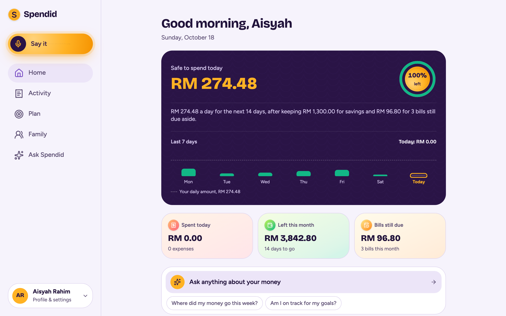

</div>

## Why Spendid

Most budgeting apps ask you to categorise every coffee and then show you charts about last month.
Spendid works the other way round:

- **One number that matters.** *Safe to spend today* takes your income, what you're saving, the
  bills and subscriptions still due this month, and what you've already spent, then splits what's
  left over the days remaining. Overspend and it says so plainly.
- **Logging takes seconds.** Say "nasi lemak 8.50, grab 12 and 40 for dinner with Sam" and each
  item is caught as you pause. Snap a receipt (or share a PDF or a payment screenshot from your bank
  app) and the lines, totals and warranty are read for you. Or just type.
- **An assistant that does things.** Ask Spendid answers from your real numbers and can set up goals,
  budgets, subscriptions and expenses, always as a card you confirm, never behind your back.
- **Family without surveillance.** Both people agree before anything is shared, each picks how much
  (totals, categories, each expense, or receipts too), and either can pause at any time. Shared savings jars and
  bill splits with a link that needs no account.
- **Private by design.** Admins manage accounts and AI limits but have no path to anyone's money,
  receipts, chats or family links. Download everything, or delete your account along with every
  receipt photo.

Built for Malaysia first (ringgit, Malay and English, local shops and habits) and works in any
currency, with automatic exchange rates.

## A quick tour

| | |
|---|---|
| 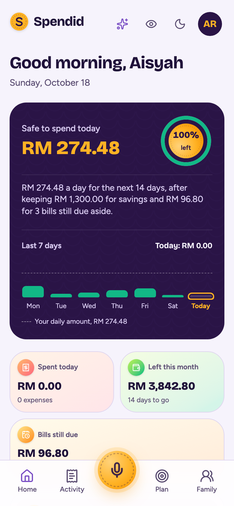 | 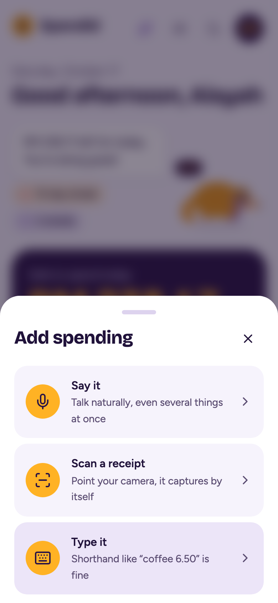 |
| **Home.** Today's safe amount, Pip's mood, your streak, where the month is heading and what's due soon. | **Capture.** Say it, scan a receipt (or share a PDF), or type it. Everything stays editable before it's saved. |
| 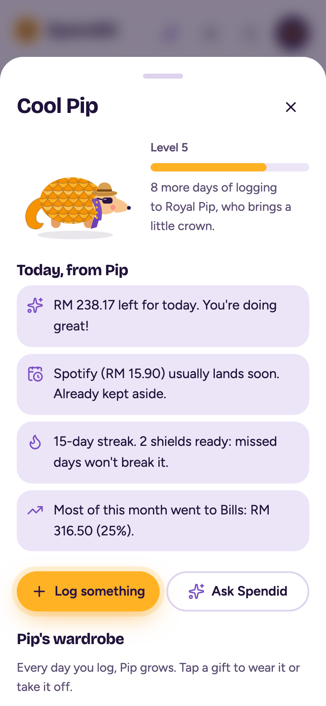 | 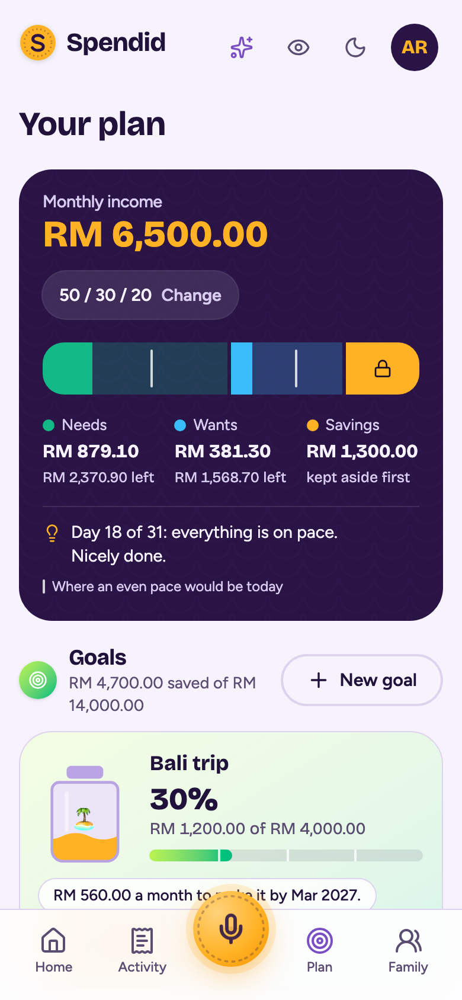 |
| **Pip.** A pangolin who curls up when you overspend, shines when you're on track, and grows (and dresses up) as you keep logging. | **Plan.** Goals with a date, budgets per category, and challenges like a no-spend weekend, checked from your spending. |
| 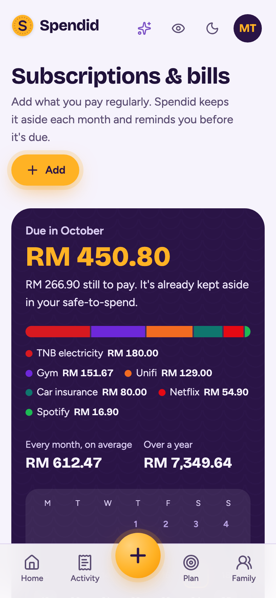 | 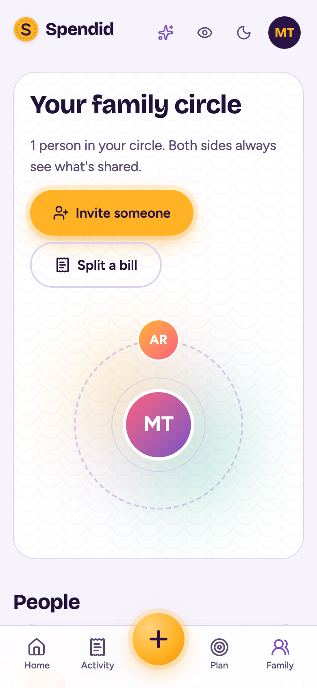 |
| **Subscriptions.** Netflix, Unifi, the gym: kept aside each month, a reminder before each is due, one tap to mark paid. | **Family.** Two-way consent, a live pulse of what your circle shares, shared jars and bill splits. |

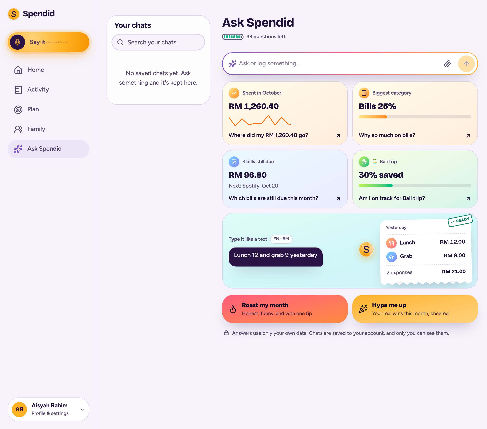

**Ask Spendid** answers in English or Malay from your own spending ("how am I doing this month?",
"can I afford headphones for 899?") and can roast or hype your month.

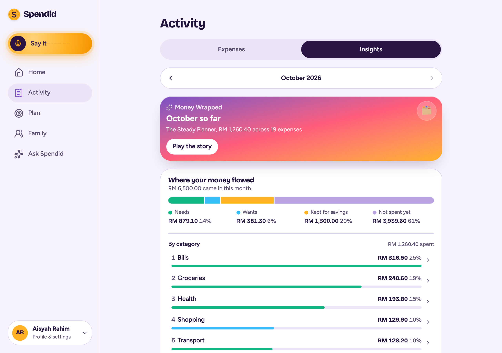

**Insights**: where your money flowed (income into needs, wants, savings and categories), a
month heatmap, subscriptions found from your spending (with price rises), and a Money Wrapped story.

<p align="center">
  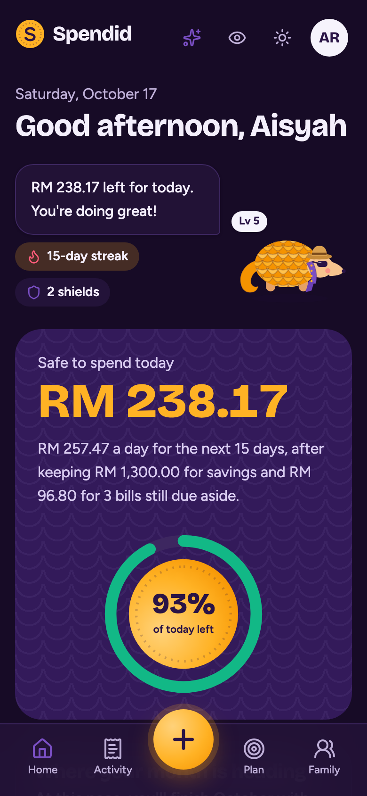
  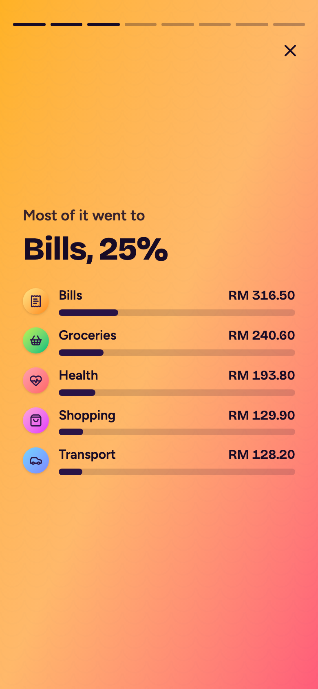
</p>

## Under the hood

| Layer | Choice |
|---|---|
| Web | React 19, Vite, TanStack Router + Query, Tailwind CSS 4, Motion; installable PWA with an offline shell |
| API | Node 24, Fastify 5, TypeScript, Zod 4, Better Auth (passwords, passkeys, email verification) |
| Data | PostgreSQL 18 + pgvector, Drizzle ORM and migrations, Redis 8 |
| Jobs | BullMQ worker: receipt reading, email, exchange rates, shop matching |
| AI | LangChain.js agent with tools and structured output, on-device voice activity detection (Silero VAD), OpenCV.js receipt edge detection in a Web Worker |
| Email | React Email templates, quiet hours, one-click unsubscribe |
| Ops | Docker Compose for dev and production, Caddy with automatic HTTPS and a strict Content-Security-Policy |

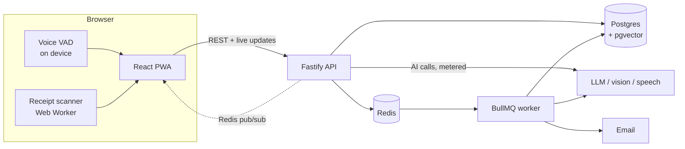

Some details worth a look:

- **Money is integers.** Every amount is minor units plus a currency; foreign spending converts at
  the rate of the day it happened.
- **Race-safe by construction.** Saving a receipt, marking a bill paid and starting a challenge
  claim their row first, so a double tap can't record twice; jar balances can't drift from their ledger.
- **AI that can't run up a bill.** Every call checks a per-person monthly allowance; calls arriving
  together each hold room atomically in Redis, and a malformed AI answer still records its tokens.
- **Admin boundary in code.** Admin routes have no imports from money modules, and a test fails the
  build if one is added.
- **Accessible.** The Playwright suite runs axe on every main page at WCAG 2.2 AA, at phone and
  desktop sizes; dialogs keep keyboard focus; reduced motion is respected.

## Run it locally

Needs Docker. Everything runs in containers with hot reload.

```bash
git clone https://github.com/khaled-saiful-islam/spendid.git && cd spendid
make up        # creates .env, then installs dependencies inside Docker (a few minutes)
make demo      # adds demo people with a month of spending
```

AI features (Ask Spendid, voice, receipt reading) call an OpenAI-compatible API, ILMU by default:
put your key in `.env` as `ILMU_API_KEY`, or point `ILMU_BASE_URL` and the model names at another
provider. Everything else works without a key, and each person's AI use has a monthly allowance.

| URL | What |
|---|---|
| http://localhost:8600 | Spendid web app |
| http://localhost:8601/api/health | API health (database + Redis) |
| http://localhost:8604 | Mailpit — every email the app sends in dev |

Postgres is on `localhost:8602`, Redis on `localhost:8603`.

**On a phone (same Wi-Fi):** `make phone-url` prints this computer's address (e.g.
`http://192.168.1.20:8600`). Add it once to `.env` as `EXTRA_ORIGINS=…`, then
`docker compose restart api`, so sign-in accepts it. Over plain HTTP, phones block the
microphone, live camera and passkeys; typing, picking a photo or PDF, and everything else work.
For voice and the camera on Android Chrome, open `chrome://flags/#unsafely-treat-insecure-origin-as-secure`,
enable it with that address, and relaunch Chrome (passkeys still need a real https address).

## Test accounts

`make up` seeds the admin. `make demo` adds normal people.

| Sign in with | Password | Who |
|---|---|---|
| `admin` | `admin` | Admin — manages accounts and the app, never sees spending (dev only; production refuses this password) |
| `maya` | `demo1234` | Normal person, set up, with this month's spending and two goals |
| `adam` | `demo1234` | Normal person, goes through onboarding on first sign-in |

New sign-ups get a confirmation email — open Mailpit at http://localhost:8604 to click it.

### Try Family Circle

maya and adam are already in each other's circle (spouses) and save into maya's "Bali trip" jar together.

1. Sign in as `maya` in one browser and `adam` in another (or a private window). Open **Family**.
2. As maya, open adam → **You share** → change the level or pause. adam's screen updates live; adam gets an email.
3. As maya, add an expense. It appears in adam's **Family pulse** within a second; adam can react 👏.
4. **Invite someone** makes a one-time link + QR (and an email if you add one). Open the link signed out:
   it asks you to sign up or sign in, then brings you back to join.
5. **Split a bill**: snap a bill or pick a recent receipt, drag each line onto a person (or tap it),
   then **Create split link**. The link opens without signing in.

### Try insights and emails

- **Activity → Insights**: the month as a heatmap, subscriptions found from spending (maya has a Netflix price rise), and Money Wrapped (tap *Play the story*).
- **Ask Spendid**: tap one of your own numbers to ask about it.
- **Emails**: `make digests u=maya`, then open Mailpit. Every optional email has *Turn them off*; choose emails, hide amounts and quiet hours under **Me → Emails**. Emails that would land in quiet hours (default 10pm–8am) wait until they end.
- Add an expense bigger than 3× your usual for its category, or the same shop and amount twice in a day, to see the alerts.

### Try trust and polish

- **Hide amounts**: the eye button in the header blurs every number on screen.
- **Bahasa Melayu**: **Me → Language**. Saved to the profile, so it follows you; Ask Spendid answers in Malay too.
- **Your data**: **Me → Your data** → *Download my data* (zip with a spreadsheet, receipts and everything else;
  an email says when it's ready) or *Delete my account* (password + type DELETE).
- **Install**: in the production build Spendid installs to the home screen and opens offline. See [docs/pwa.md](docs/pwa.md).
- **Production**: [docs/deploy.md](docs/deploy.md) — one command with HTTPS by Caddy.

### Try the newest features

- **Ask Spendid creates things**: "save 5000 for a laptop by June 2027", "put 50 into Bali trip",
  "cap eating out at 400", "should I buy headphones for 899?", "track Netflix 54.90 on the 5th",
  "lunch 12 and grab 9". Each shows a card; nothing is saved until you tap it.
  **Roast my month** / **Hype me up** for a playful take on your real numbers.
- **Chats**: saved to your account; the chats panel (desktop) or **Chats** button (phone) has search,
  day groups and one-tap delete with Undo. The battery shows AI questions left; tap it for details.
- **Voice**: talk as long as you like; each phrase is caught as you pause, then edit everything.
- **Subscriptions & bills** (Plan → Subscriptions, or the due-soon card on Home): add Netflix, Unifi,
  the gym…; due amounts are kept aside each month, a reminder email comes N days before, Mark paid logs it.
- **Home**: Pip (tap for the briefing and wardrobe; Pip grows as you log), streak shields,
  **Where your month is heading** with a what-if slider.
- **Plan → Challenges**: no-spend weekend, cook-at-home week and more, checked from your spending.
- **Insights → Where your money flowed**: income into needs, wants, savings and categories.
- **Receipts**: photos, screenshots or PDFs. Installed on Android, Spendid is in the share menu.
- **Onboarding** (Me → change style, or a new account): watch your pay sorted live, then the reveal.

## Commands

| Command | Does |
|---|---|
| `make up` / `make down` | Start / stop (data is kept) |
| `make logs s=api` | Follow logs for one service (`api`, `web`, `worker`, `db`) |
| `make install` | Reinstall after editing a `package.json` |
| `make demo` | Create the demo people above |
| `make digests u=maya` | Send someone's weekly summary, bill, warranty and Wrapped emails now (normally scheduled) |
| `make db-generate` | New migration after editing `packages/db/src/schema` |
| `make test` | Unit + API tests |
| `make coverage` | The same tests with a coverage summary per package |
| `make e2e` | Browser + accessibility tests at phone and desktop sizes (on your machine; needs `make up` + `make demo`) |
| `make phone-url` | The address to open Spendid on a phone on the same Wi-Fi |
| `make typecheck` | TypeScript 7 across all packages |
| `make check` / `make fix` | Biome lint + format |
| `make reset` | Delete all local data (asks first) |

## Layout

```
apps/api        Fastify 5 API (Better Auth, agent, routes)
apps/web        React 19 PWA (Vite, TanStack Router + Query, Tailwind 4, Motion)
apps/worker     BullMQ jobs (receipts, email, recap, reminders)
packages/shared Zod schemas, money math, shared types
packages/db     Drizzle schema, migrations (applied by the `migrate` service on every `make up`)
packages/emails React Email templates + the email job contract
e2e/            Playwright + axe browser tests (runs on the host)
docker/         Dev image, production image + Caddyfile
docs/           Feature docs
```

## Rules worth knowing

- Money is stored as integer minor units + currency. Use `toMinor` / `formatMinor` from `@spendid/shared`.
- Admins manage accounts and AI limits. They can never read anyone's spending.
- Sharing between people always needs both sides to agree, and can be paused at any time.
  The "what they see" preview uses the same code as the other person's screen, so they can't differ.

## Quality

- **CI** (GitHub Actions): Biome lint and format, TypeScript across every package, a production
  build of the web app, a dependency audit, and the unit + API tests against real Postgres and Redis.
- **Tests**: Vitest unit and integration tests (the API ones run against a real database), plus a
  Playwright suite with axe accessibility checks at phone and desktop sizes. See
  [docs/testing.md](docs/testing.md).
- **Docs**: privacy and data, languages, installing as an app, deploying, testing:
  [docs/](docs/README.md). Product spec: [SPEC.md](SPEC.md). Build plan: [PLAN.md](PLAN.md).

## License

[MIT](LICENSE) © 2026 Khaled Saiful Islam
